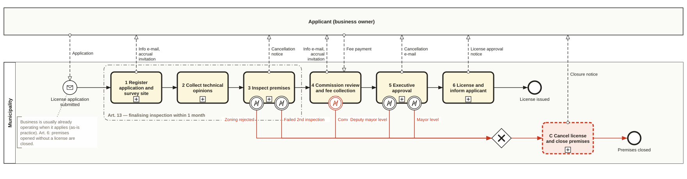

# Municipal License Process Modeling with BPMN 2.0

End-to-end analysis and BPMN 2.0 modeling of a municipal licence process, completed during my work as a Business Analyst at Universal Bilgi Teknolojileri. The model was the foundation of a working software flow and was implemented in the product.

The process licenses *sıhhi* premises (shops, cafés, restaurants without alcohol service) in an Istanbul district municipality, around 2014–2015. It is a **software process map**: each user task is a screen or form in the municipal system, where staff enter data, scan documents such as the tax certificate and issue printed documents.

This repository shows the work twice: **before**, the original model exactly as I drew it, and **after**, the same process restructured into a navigable, machine-readable set of diagrams and checked against current legislation.

## Before: the original model

The complete, end-to-end BPMN 2.0 model I created during the analysis. It is kept unchanged as the primary artifact: about 40 tasks, a dozen roles, parallel reviews, approvals, rejection paths, inspections and return loops in a single view.

[Open the full-resolution diagram](diagrams/license-process-bpmn.jpg)

## What was restructured, and why

The original works as a complete record, but one large view makes it hard to see who does what, where a stage ends, or how the process relates to the law. The restructuring kept every step and changed only how the process is organised:

| Before | After | Why |
| --- | --- | --- |
| One diagram with about 40 tasks | An overview of six stages, one detailed diagram per stage, shown as tabs | Read the whole process at a glance, then open any stage in full detail |
| Roles written in notes and task names | Swim lanes per role | Handoffs between units become visible |
| Some decisions and paths without labels | Every decision has a question and labelled outcomes; added labels are in italics | Decisions can be read without guessing |
| An image | BPMN 2.0 XML that opens in Camunda Modeler or demo.bpmn.io, generated from one source model | Editable, versionable, checkable |
| No link to legislation | Step-by-step comparison with the regulation, as of 2026 | Shows which steps the law requires and which are internal practice |
| Cancellation ended with a notice | Cancellation leads to closure of the premises (added, marked in red) | The business is usually already operating, so cancellation means closure |

Every original step is traced to its new position in [v2-traceability.md](docs/v2-traceability.md): 43 of 43, none removed or renamed. Elements that are not in the original are drawn in red with a dashed border and listed separately.

## After: the structured model (v2)

In practice businesses were usually already operating when they applied, so the process reads as **declaration → finalising inspection → final licence, or cancellation and closure**.

| Stage | Diagram | BPMN file |
| --- | --- | --- |
| 1 Register application and survey site | [SVG](diagrams/v2/01-register-and-survey.svg) | [BPMN](model/v2/01-register-and-survey.bpmn) |
| 2 Collect technical opinions | [SVG](diagrams/v2/02-technical-opinions.svg) | [BPMN](model/v2/02-technical-opinions.bpmn) |
| 2a Prepare zoning opinions | [SVG](diagrams/v2/02a-zoning-opinions.svg) | [BPMN](model/v2/02a-zoning-opinions.bpmn) |
| 3 Inspect premises | [SVG](diagrams/v2/03-site-inspection.svg) | [BPMN](model/v2/03-site-inspection.bpmn) |
| 4 Commission review and fee collection | [SVG](diagrams/v2/04-commission-and-fee.svg) | [BPMN](model/v2/04-commission-and-fee.bpmn) |
| 5 Executive approval | [SVG](diagrams/v2/05-executive-approval.svg) | [BPMN](model/v2/05-executive-approval.bpmn) |
| 6 License and inform applicant | [SVG](diagrams/v2/06-licensing.svg) | [BPMN](model/v2/06-licensing.bpmn) |
| C Cancel license and close premises (added) | [SVG](diagrams/v2/07-cancellation-and-closure.svg) | [BPMN](model/v2/07-cancellation-and-closure.bpmn) |

How to read the diagrams: a person icon is a screen in the software, a hand icon is physical work on site, an envelope is an automated SMS or e-mail notice. Dotted notes give legal references and interpretations.

## What the legal comparison showed

- The core rules have not changed since the process was drawn: a compliant declaration gets a licence the same day, and the premises are inspected within one month, with one 15-day period to fix deficiencies.
- The process follows the law where it matters: fire reports only for premises that need them, zoning control, the opening permit fee, and cancellation by the mayor or a delegate.
- The commission and the two-level executive approval are internal practice, not legal requirements.
- Today the process would also need a professional-competence document check (2020) and tracking of the two-month limit after which the Ministry can issue the licence (2025).

Details and sources: [legal-basis.md](docs/legal-basis.md).

## What I worked on

- Analyzed the process from application to final licence
- Identified user roles, responsibilities and handoffs
- Defined decision points and alternative process outcomes
- Modeled parallel reviews and dependent activities
- Included rejection, cancellation, correction and resubmission scenarios
- Designed inspection and reinspection loops
- Converted the complete workflow into a BPMN 2.0 model
- Supported the transfer of business rules into the software workflow
- Contributed to the successful implementation of the process in the product

## Why BPMN 2.0 was useful

BPMN 2.0 gave business stakeholders and the software team a shared language. It made the sequence of work, decision logic and role transitions visible before and during implementation, and helped the team:

- Discuss the complete workflow through a single process view
- Clarify responsibilities and transition points
- Detect missing paths and unclear decisions
- Translate business rules into software states and actions
- Review exception scenarios before implementation

## Outcome

The analyzed process was implemented as a working software flow. The model served as a practical bridge between operational requirements and product development, rather than remaining a standalone diagram.

## Skills demonstrated

- Business process analysis
- BPMN 2.0 process modeling
- Business-rule definition
- Role and responsibility analysis
- Exception and edge-case modeling
- Regulatory comparison
- Requirements communication
- Collaboration with software development teams

## Repository contents

| Path | Content |
| --- | --- |
| `diagrams/license-process-bpmn.jpg` | **Original model**, unchanged |
| `model/v2/*.bpmn` | Structured model, BPMN 2.0 XML |
| `diagrams/v2/*.svg` | Rendered structured diagrams |
| `docs/process-overview.md` | The process stage by stage |
| `docs/structured-model-v2.md` | How v2 is organised, every change and addition |
| `docs/legal-basis.md` | Comparison with legislation, changes since 2015 |
| `docs/v2-traceability.md` | Original step → v2 position, plus added elements |
| `docs/v2-responsibilities.md` | Who does what, per stage |
| `docs/v2-milestones.md` | Stage milestones and outcomes |
| `docs/modeling-decisions.md` | Modeling decisions |
| `docs/implementation-notes.md` | How the analysis supported implementation |
| `case-study/case-study.md` | Short case study |
| `tools/v2/` | Source model and build script that generate the v2 files |
| `archive/` | Earlier high-level reading guide, kept for reference |
